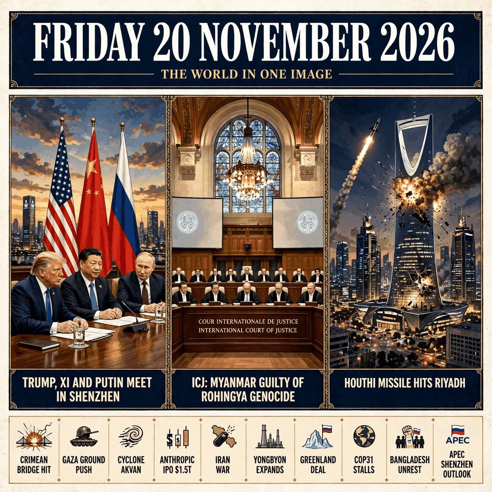

# Friday 20 November 2026 — The World in One Image

One unified editorial tableau summing up Friday 20 November 2026.
A triptych of three hero panels under a single masthead, with a clean
supporting strip below — one coherent composition in a single navy,
gold and cream palette, not a collage.

## The triptych

- **Trump, Xi and Putin meet in Shenzhen** — the first-ever trilateral
  meeting at APEC: 90 minutes behind closed doors, nuclear arms control,
  Ukraine, Iran and trade on the table, a "peace declaration" but no
  major agreement.
- **ICJ: Myanmar guilty of Rohingya genocide** — the International Court
  of Justice rules Myanmar committed genocide against the Rohingya, the
  first ruling of its kind, by 9–6: state responsibility, restitution
  and investigations.
- **Houthi missile hits Riyadh** — a missile strikes the King Abdullah
  Financial District, damaging the PIF Tower; no casualties.

## The supporting strip

Crimean Bridge hit again · Israel's ground push in central Gaza ·
Cyclone Akvan bearing down on Odisha · Anthropic's record IPO ·
the Iran war · North Korea expanding uranium enrichment at Yongbyon ·
Denmark's Greenland defence deal · COP31 stalling on fossil fuels ·
unrest in Bangladesh · the APEC Shenzhen Outlook.

## Entry

`main.py` (Python 3.13, stdlib only) copies `entry.png` to
`/output/entry.png`. See the [bounty](https://make.fun/bounty/news-image-20261120?ref=5548afh3).
